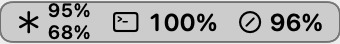
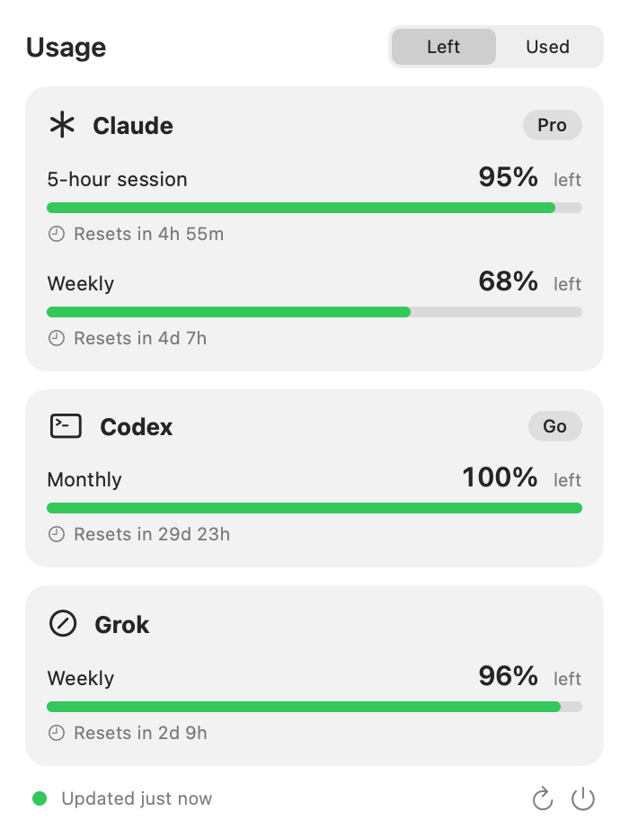
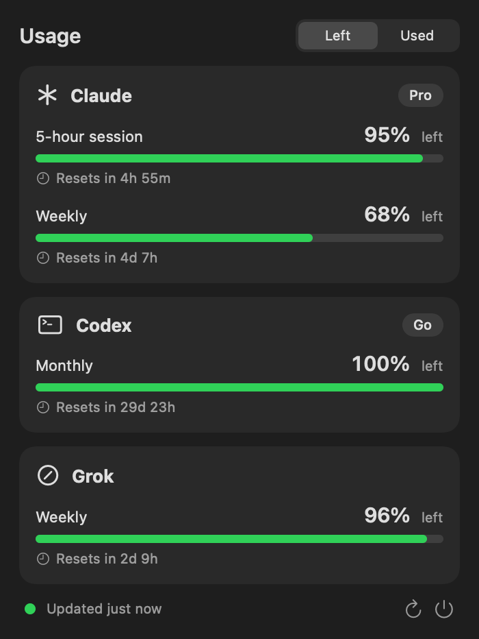

# UsageBar

A small macOS menu-bar app that shows how much of your **Claude**, **ChatGPT (Codex)** and **Grok** quota you have left, at a glance.

<p align="center">
  
  &nbsp;&nbsp;
  
</p>
<p align="center">
  
  
</p>

- **Menu bar:** one glyph per provider with up to two stacked numbers (for example the 5-hour and weekly windows), framed in a thin pill. Numbers turn orange below 40% left and red below 20%, and dim when the data is stale.
- **Popover:** a card per provider with plan, each limit window, a bar, and "Resets in …". A **Left / Used** toggle flips every number.
- **Refresh:** every 5 minutes, on wake, and when you open the popover (never more than once a minute).
- **Native and tiny:** SwiftUI + AppKit, about 800 lines, no dependencies, no Dock icon.

## Read-only by design

UsageBar **never writes** a token, a Keychain item or any provider config. The official CLIs rotate refresh tokens, and a second program refreshing them can log you out, so UsageBar only ever *reads* what the CLIs already keep fresh:

| Provider | Credentials read | Endpoint called |
|---|---|---|
| Claude | Keychain item `Claude Code-credentials` (fallback: `~/.claude/.credentials.json`) | `api.anthropic.com/api/oauth/usage` |
| Codex / ChatGPT | `~/.codex/auth.json` | `chatgpt.com/backend-api/wham/usage` |
| Grok | `~/.grok/auth.json` | `cli-chat-proxy.grok.com/v1/billing` |

If the Claude login has expired it does not call at all and tells you to use Claude Code once, which renews itself. For Grok, when the token is stale it runs `grok models` (at most once every 20 minutes) so the Grok CLI renews itself.

Credentials go only to the provider's own host, nowhere else. There is no telemetry and no server of ours.

> **Heads-up:** these usage endpoints are undocumented and are the ones the official tools use. They can change or break without notice, and using them may not be covered by a provider's terms. Use at your own risk.

## Requirements

- macOS 14 or later (Apple Silicon or Intel, built for the machine you build on)
- The CLIs you want shown, signed in at least once: Claude Code, Codex, Grok. Providers without a login show a short hint instead.
- Xcode Command Line Tools (`xcode-select --install`) to build. No Xcode project is needed.

## Build and install

```sh
git clone https://github.com/Marcus1571/usagebar.git
cd usagebar
./scripts/build-app.sh --install     # builds, ad-hoc signs, copies to ~/Applications
open ~/Applications/UsageBar.app
```

Without `--install` the app is left in `build/UsageBar.app`. To start it at login, add it in System Settings → General → Login Items.

The build uses plain `swiftc` on purpose: it is one module, and SwiftPM is broken on some Command Line Tools versions.

### Signing and distribution

This repository ships **no certificates, no signed binaries and no Apple account details**. You build and sign your own copy:

- **Default:** ad-hoc signature (`codesign --sign -`). It runs fine on the Mac that built it and needs no Apple account.
- **Your own certificate:** `SIGN_IDENTITY="Developer ID Application: Your Name (TEAMID)" ./scripts/build-app.sh` signs with your Developer ID. Notarize it yourself with `xcrun notarytool` if you want to hand it to other people without a Gatekeeper warning.
- **Your own bundle id:** the default is `local.usagebar`; override it with `BUNDLE_ID=com.example.usagebar`.
- **Sharing an ad-hoc build:** Gatekeeper blocks a downloaded copy on another Mac. Open System Settings → Privacy & Security and choose **Open Anyway**, or run `xattr -dr com.apple.quarantine UsageBar.app`. Building from source on that Mac avoids the warning.

## Command line

```sh
build/UsageBar --selftest        # parser checks against real response shapes (no network)
build/UsageBar --dump            # fetch once and print the numbers, no UI
build/UsageBar --render DIR      # write label and popover PNGs with live data
build/UsageBar --open            # launch and auto-open the popover (handy for screenshots)
```

## Project layout

```
Sources/UsageBar/
  Model.swift      Provider, UsageWindow, Snapshot, ProviderState
  Fetch.swift      credentials readers and the three provider clients
  Store.swift      refresh logic (rate limit, concurrent fetch, keeps last good data)
  Views.swift      menu-bar label (rendered to an image) and popover
  SelfTest.swift   parser and formatting checks
  main.swift       app delegate, status item, CLI modes
scripts/build-app.sh   build, bundle, sign, install
scripts/make-icon.sh   icon/icon.svg -> icon/AppIcon.icns (needs librsvg)
```

## Contributing

Issues and pull requests are welcome, especially for a provider's response changing. Please keep it read-only, dependency-free and small. See [CONTRIBUTING.md](CONTRIBUTING.md).

## Credits

Look and feel borrow ideas from [Quota](https://github.com/turinlabsorg/quota), AI Usage, ClaudeBar and Orca's status bar. No code was copied.

## License

[MIT](LICENSE)
