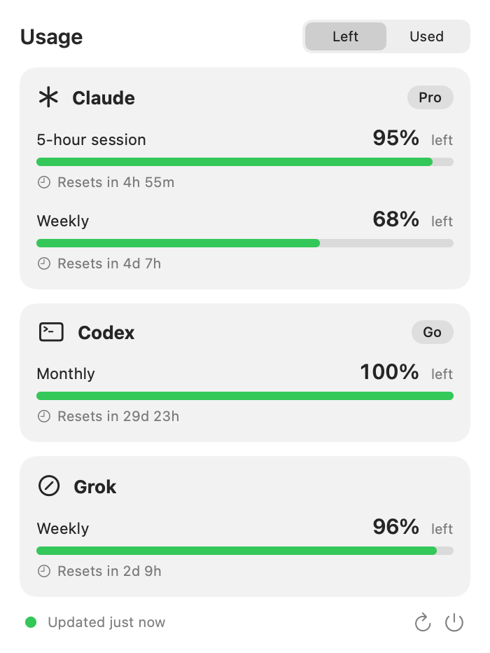
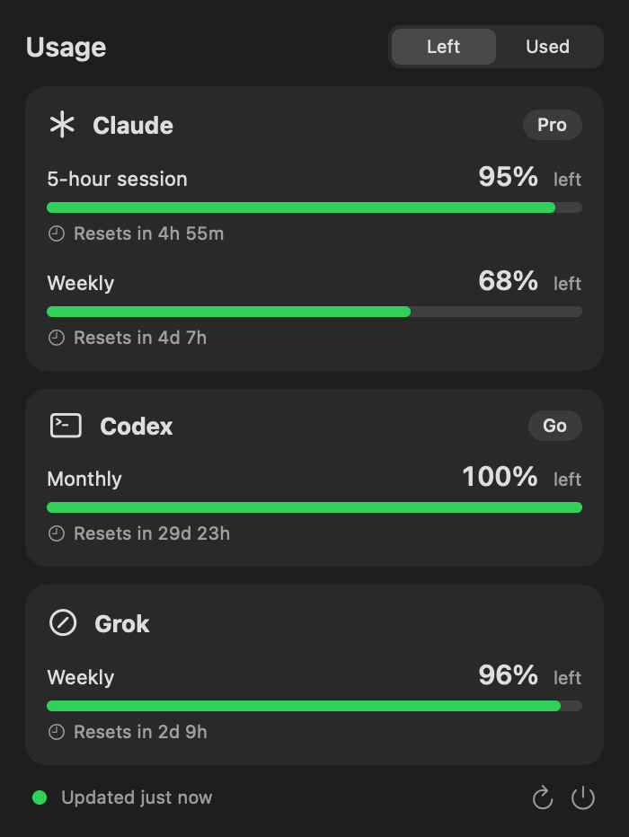

# UsageBar

[Reference: KB.md](KB.md) · [Changelog](CHANGELOG.md)

A small macOS menu-bar app that shows how much of your **Claude**, **ChatGPT (Codex)**, **Grok**, **OpenCode Go** and **GitHub Copilot** quota you have left, at a glance.

<p align="center">
  
  &nbsp;&nbsp;
  
</p>
<p align="center">
  
  
</p>

- **Menu bar:** one glyph per provider with up to two stacked numbers (for example the 5-hour and weekly windows), framed in a thin pill (the frame style is a [Setting](KB.md#behavior-constants)). Numbers turn orange below 40% left and red below 20%, and dim when the data is stale. Providers you are not signed in to [stay out of the bar and the popover](KB.md#behavior-constants), so a new provider simply appears once you log in to its CLI.
- **Popover:** a card per provider with plan, each limit window, a bar, and "Resets in …". A **Left / Used** toggle flips every number, and a gear button opens a **Settings window** with a live label preview, per-provider show/hide toggles, the refresh interval and **Check for Updates** ([KB](KB.md#behavior-constants)).
- **Self-updating:** shipped as a notarized DMG with [Sparkle](KB.md#distribution-and-updates) — startup and weekly checks, automatic installs.
- **Refresh:** every 5 minutes by default (configurable), on wake, and when you open the popover (never more than once a minute).
- **Native and tiny:** SwiftUI + AppKit, about 1,000 lines, no dependencies, no Dock icon.

## Read-only by design

UsageBar **never writes** a token, a Keychain item or any provider config. The official CLIs rotate refresh tokens, and a second program refreshing them can log you out, so UsageBar only ever *reads* what the CLIs already keep fresh:

| Provider | Credentials read | Endpoint called |
|---|---|---|
| Claude | Keychain item `Claude Code-credentials` (fallback: `~/.claude/.credentials.json`) | `api.anthropic.com/api/oauth/usage` |
| Codex / ChatGPT | `~/.codex/auth.json` | `chatgpt.com/backend-api/wham/usage` |
| Grok | `~/.grok/auth.json` | `cli-chat-proxy.grok.com/v1/billing` |
| OpenCode Go | `~/.local/share/opencode/auth.json` (`opencode auth login`) | `opencode.ai/zen/go/v1/usage` |
| GitHub Copilot | the GitHub CLI login, via `gh auth token` (`gh auth login`) | `api.github.com/copilot_internal/user` |

If the Claude login has expired it does not call at all and tells you to use Claude Code once, which renews itself. For Grok, when the token is stale it runs `grok models` (at most once every 20 minutes) so the Grok CLI renews itself.

Credentials go only to the provider's own host, nowhere else. There is no telemetry and no server of ours.

> **Heads-up:** these usage endpoints are undocumented and are the ones the official tools use. They can change or break without notice, and using them may not be covered by a provider's terms. Use at your own risk.

## Energy use

UsageBar is idle between refreshes (idle CPU is about 0.0%). It wakes once every 5 minutes (with tolerance, so macOS can batch the wake-up), after the Mac wakes, and when you open the popover. The menu-bar label is re-rendered only when a displayed value changes, and the popover exists only while it is open.

## Requirements

- macOS 14 or later (Apple Silicon or Intel, built for the machine you build on)
- The CLIs you want shown, signed in at least once: Claude Code, Codex, Grok, OpenCode (Go plan), GitHub CLI (for Copilot). Providers without a login are simply not shown.
- Xcode Command Line Tools (`xcode-select --install`) to build. No Xcode project is needed.

## Install

Download the latest DMG from [GitHub Releases](https://github.com/Marcus1571/usagebar/releases) — it is Developer ID–signed and notarized by Apple, so Gatekeeper opens it silently. Drag **UsageBar** to Applications, launch it, and add it to Login Items if you want it at startup. The app [checks for updates automatically](KB.md#distribution-and-updates) (startup + weekly) and installs them itself, or use **Settings → Check for Updates…**.

## Build from source

```sh
git clone https://github.com/Marcus1571/usagebar.git
cd usagebar
./scripts/build-app.sh --install     # builds, ad-hoc signs, copies to ~/Applications
open ~/Applications/UsageBar.app
```

Without `--install` the app is left in `build/UsageBar.app`. To start it at login, add it in System Settings → General → Login Items.

The build uses plain `swiftc` on purpose: it is one module, and SwiftPM is broken on some Command Line Tools versions. The dev build has no dependencies; the packaged build embeds [Sparkle](https://sparkle-project.org) for self-updates, fetched pinned and hash-verified at package time.

Signing with your own Developer ID, the notarized DMG, the command-line test modes and the source layout are all in the [knowledge base](KB.md#distribution-and-updates).

## Contributing

Issues and pull requests are welcome, especially for a provider's response changing. Please keep it read-only, dependency-free and small. See [CONTRIBUTING.md](CONTRIBUTING.md).

## Credits

Look and feel borrow ideas from [Quota](https://github.com/turinlabsorg/quota), AI Usage, ClaudeBar and Orca's status bar. No code was copied.

## License

[MIT](LICENSE)
